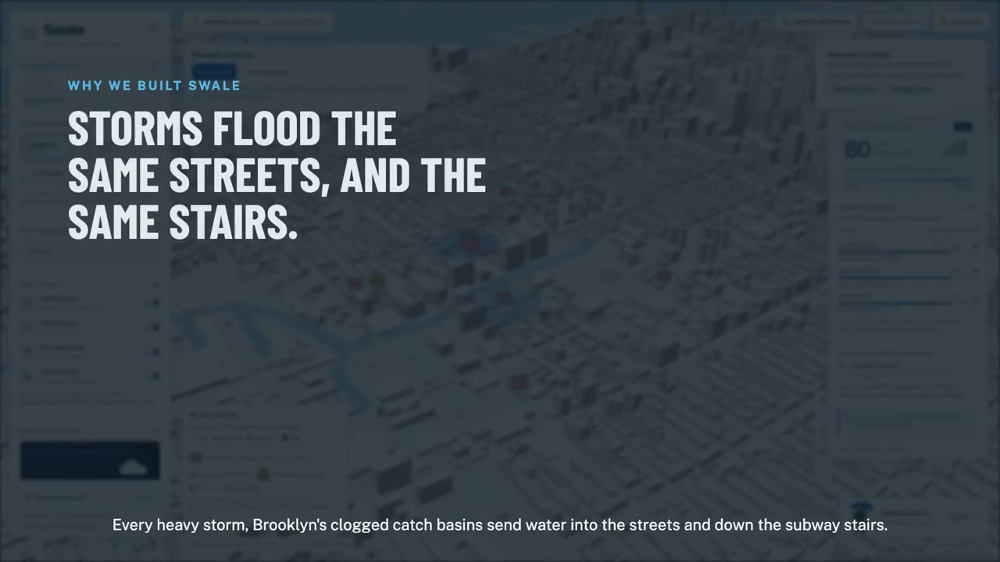

<p align="center">
  
</p>

<h1 align="center">Swale</h1>
<p align="center"><b>Urban flood readiness for Brooklyn, built on evidence.</b><br>
<a href="https://d1tl5jij0x3sdf.cloudfront.net">Live app</a> · <a href="docs/media/swale-tour.mp4">2:47 tour video</a> · <a href="docs/DEMO.md">Demo script</a></p>

<p align="center">
  <a href="docs/media/swale-tour.mp4" title="Watch the Swale tour video"></a>
</p>

Swale joins NYC's flood data (DEP catch basins, 311, FloodNet, NWS, MTA) into one map. It watches the rain forecast
and, at watch or warning level, simulates the storm, ranks which clogged drains to clear first, and briefs crews by
voice in several languages. Every feature is labelled **observed**, **reported**, **predicted** or **inferred**.
The demo area is Brooklyn Community District 6 (BK0601). The storm model is a schematic, uncalibrated demonstrator.

## Run it

Requires Python 3.12 with [uv](https://docs.astral.sh/uv/), and Node 22.12 or newer. API keys are optional.

**Backend** (API on http://127.0.0.1:8000, demo console at `/dev/map`):

```bash
cd backend
uv sync
./scripts/fix_swmm_macos.sh                              # Apple Silicon only, once: re-signs the SWMM library
uv run swale ingest --from-snapshot sample_data/bk0601   # loads the committed real data, about 5 s, no network
uv run swale serve
```

**Frontend** (3D map, in a second terminal; proxies `/api` to the backend):

```bash
cd frontend
npm ci
npm run dev                                              # http://127.0.0.1:5173
```

In the app, set **Data mode** to **Backend / snapshot + transit** for live data. Take the built-in tour from the
**How to Use Swale** button.

Stop `swale serve` before running `swale ingest`: the embedded database allows one writer.

### Optional keys

Copy `backend/.env.example` to `backend/.env` (gitignored) and fill in what you have. Without keys everything runs
except the features below.

| Key | Enables |
| --- | --- |
| `DAYTONA_API_KEY` | Simulations in Daytona sandboxes and parallel sweeps (local runner otherwise) |
| `AWS_BEARER_TOKEN_BEDROCK` or AWS access keys | Claude-written briefings, translations and quality judge (template briefings otherwise) |
| `ELEVENLABS_API_KEY`, `ELEVENLABS_VOICE_ID` | Spoken briefings and voice-note inspections |
| `ARIZE_SPACE_ID`, `ARIZE_API_KEY` | Tracing and evaluations |
| `SWALE_SOCRATA_APP_TOKEN` | Higher NYC Open Data rate limits for live ingest |
| `SWALE_ALERT_MONITOR=1` | Rain monitor that starts alert packs on its own |

### Refreshing data

```bash
uv run swale ingest                    # live NYC Open Data pull for BK0601
uv run swale flood-maps                # DEP Stormwater Flood Maps for the area
uv run swale transit-data              # MTA stations, entrances and this week's schedule
```

The committed subway schedule covers October 16-23, 2026. After that, delays read blank until `transit-data` is re-run.

## How it works

```
NYC Open Data, NWS, MTA, NOAA ──► ingest ──► SurrealDB (embedded) ──► FastAPI ──► React + deck.gl 3D map
                                                  │                      │
                  EPA SWMM runs (local or Daytona)┘                      └─► Bedrock briefings ─► ElevenLabs audio
                                                                              (traced and evaluated in Arize)
```

| Layer | Tool | Role |
| --- | --- | --- |
| Database | SurrealDB (embedded) | Geometry, complaint-to-basin graph links, results, briefings, inspections; change feeds push live updates |
| Simulation | EPA SWMM 5.2, Daytona | One drainage area per basin; runs in isolated sandboxes, nine at a time |
| Ranking | Rule-based `risk-v2` | Weighted factors with evidence; tested against a year of real outcomes (`docs/validation.md`) |
| Briefings | Claude Opus 5.5 on Amazon Bedrock | Written from an evidence pack; code checks every citation and falls back to a template |
| Voice | ElevenLabs | Briefings in five languages; Scribe transcribes voice inspections |
| Quality | Arize | Traces and per-prompt faithfulness scores |
| Backend | Python, FastAPI, pydantic | Versioned GeoJSON API with bounding-box queries |
| Frontend | React, TypeScript, Vite, MapLibre, deck.gl | 3D map, station models, guided tour |
| Hosting | AWS EC2 and CloudFront | `deploy/aws/launch.py` |

Code layout: `backend/swale/` (api, ingest, sim, risk, ai, alerts, transit, weather, db), `frontend/src/`,
`deploy/aws/`, `docs/`.

## Test

```bash
cd backend && uv run pytest              # 287 tests
cd frontend && npm test                  # 311 tests
cd backend && uv run python scripts/smoke.py https://d1tl5jij0x3sdf.cloudfront.net   # checks every endpoint on a running server
```

## Deploy to AWS

From `backend/`, with AWS credentials and the app's keys in `backend/.env`:

```bash
uv run python ../deploy/aws/launch.py launch    # EC2 + CloudFront, prints the HTTPS address
uv run python ../deploy/aws/launch.py secrets   # send the app's keys to the server
uv run python ../deploy/aws/launch.py update    # later: pull main, rebuild, restart
```

## More

- [API contract](docs/api/v1.md) · [data sources](docs/data-sources.md) · [ranking validation](docs/validation.md)
- [Demo script](docs/DEMO.md) · [design notes](docs/design/) · [frontend verification](frontend/VERIFICATION.md)
- Subway station models and flood what-if: [infrastructure](docs/SUBWAY_INFRASTRUCTURE.md), [equations and limits](docs/STATION_FLOOD_WHAT_IF.md)

## Limits

Swale does not establish current flooding, blockage, station safety or closure. A 311 report is a complaint, not proof;
only DEP's own resolution text counts as a confirmed obstruction. The simulation has no sewer network or terrain.
MTA publishes no station flood sensors, so a station shows "flooding reported" only when an MTA alert says so.
