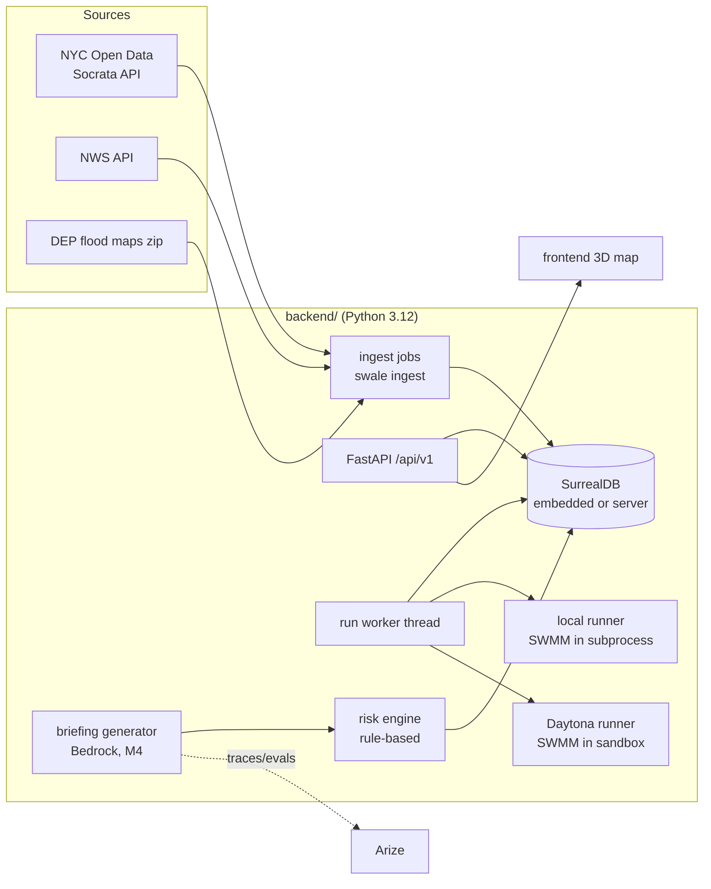

# Swale backend design

- **Status:** DRAFT for review. Not yet approved.
- **Date:** 2026-10-15.
- **Scope:** backend, database, data pipelines, simulation, risk ranking, and API. The frontend and 3D map are owned separately.
- **Companion docs:**
  - [`docs/data-sources.md`](../data-sources.md): the verified data-source register.
  - [`docs/api/v1.md`](../api/v1.md): the frontend contract.

---

## 1. What exists today

- **Repo `devauntea/Swale`:** one commit (`bef331c`, 2026-10-15). It contains a `README.md` that reads `# Swale`.
  - There's no code, no stack and no conventions to preserve, so this is a greenfield build.
  - Collaborators: `devauntea` (backend) and `kjean230`. `kjean230` is presumably the frontend owner, Kerwyn Jean, who made the first commit.
- **Reference repo `gain9999/dtm`:** Apache-2.0. A client-side Leaflet and deck.gl viewer.
  - It streams a 30 m global DEM, does a "bathtub" flood fill over connected low cells, and extrudes buildings.
  - It's a useful pattern for the frontend's 3D and flood rendering.
  - It is **not** a backend dependency. 30 m cells are too coarse for street-scale Brooklyn.
- **Local machine:** macOS arm64.
  - System Python is 3.9.6. The geo libraries need 3.12 (`pyproj` 3.8 and `rasterio` 1.5 need ≥ 3.12), which `uv` 0.11.29 can manage.
  - **Docker Desktop won't start**, so the local setup must not depend on Docker.

## 2. Scope

**Goals for the hackathon build**
1. Load DEP catch basins and the relevant 311 reports for one Brooklyn demo area, with full provenance.
2. Serve them as map layers that can be filtered by bbox.
3. Run reproducible SWMM rainfall scenarios. Store their configuration, logs, results and model versions.
4. Rank basins for inspection with transparent factors and evidence IDs.
5. Add AI briefings, tracing and stretch feeds only after the core loop works.

**Non-goals**
- Calibrated street-level depth predictions.
- Citywide coverage on day one.
- Operational emergency alerting.
- User accounts or authentication.
- Vector tiles. Add them only if GeoJSON gets too heavy.

## 3. Findings that shape the design

Each of these was verified on 2026-10-16 UTC; see the register for detail.

1. **The basin inventory only has location and ID.** The six fields are geometry, `unitid`, lat/lon and State Plane X/Y. There's no condition, inspection date or borough. Condition must come from evidence, never from an assumed default.
2. **DEP's resolution text records what inspectors found.** Examples: "found that debris was obstructing the catch basin" (1,947 Brooklyn complaints since 2024), "could not find the problem" (1,244), and "surcharge conditions… due to rain intensity" (17, a capacity problem rather than a blockage). This gives an evidence tier between "someone complained" and "we inspected".
3. **Two 311 taxonomies are in use at once:** `Sewer` with coded descriptors, and the growing `Sewer Maintenance` type with plain descriptors. The normalizer maps both.
4. **FloodNet is the observed ground truth.** BK0601 has 15 sensors, the most of any Brooklyn NTA, and 2 of them are tidally influenced. The data refreshes every two weeks. Timestamps are GMT, unlike 311.
5. **DEP's stormwater flood maps model 1.77, 2.13 and 3.66 in/hr.** Using the same design storms gives a like-for-like comparison with an authoritative model.
6. **None of the checked sources includes the sewer pipe network.** Any SWMM model will be *schematic* (see §10). It's a demonstrator, not a calibrated model.
7. **SurrealDB has no spatial index.** The available types are standard, UNIQUE, COUNT, FULLTEXT and HNSW/DISKANN. However, its Python SDK runs **embedded**, which removes the need for a server or Docker.
8. **NWS has forecast rainfall but no history.** Rainfall amounts (QPF) come in mm over 6-hour ISO-8601 intervals. Validating against past flood events needs another rainfall source.
9. **Terrain options:** Planimetric `feat_code` 3000 points look like ground spot heights (mean 43 ft, versus 99 ft for the 3020 roof points). This must be confirmed with the data dictionary. The 1 ft DEM is from 2010 LiDAR.

## 4. Approaches considered

### 4.1 Database and spatial queries

| | Approach | Pros | Cons |
|---|---|---|---|
| **A (recommended)** | **SurrealDB as the only store.** Heavy GIS work (clipping, nearest-basin, polygon overlay, raster sampling) runs in Python with shapely/pyproj at ingest or post-processing time. SurrealDB stores the results. Bbox queries use indexed `lat` range scans plus a `lon` filter. | One database, as the brief asks. Embedded mode means no Docker. Graph edges (incident → basin) fit SurrealDB well. | No spatial index, so bbox speed must be measured. Complex spatial joins happen in Python, not SQL. |
| B | SurrealDB plus PostGIS: PostGIS for spatial queries, SurrealDB for records and graph. | Mature GIS. | Two stores to keep in sync, and PostGIS needs Docker or Postgres.app. That's the most moving parts. |
| C | PostGIS only. | The most capable GIS. | Drops the SurrealDB requirement. Needs a Postgres install. |

**Gate in M1.** The first M1 task is a `bench-bbox` spike. It measures bbox queries for a typical map viewport, about 1 km², at two scales.
- **Demo scale (BK0601, about 2,100 basins).** The p95 must be under 200 ms, or M1 fails.
- **Brooklyn scale (about 40,000 points; synthetic, benchmark-only).** If the p95 is under 200 ms, expanding beyond the demo area can use A unchanged. If not, M1 still ships for the demo area, and we choose between a tile-key index and option C before expanding.

### 4.2 Flood simulation

| | Approach | Pros | Cons |
|---|---|---|---|
| **A (recommended)** | **A SWMM "demonstrator" network built from basins** (see §10), with DEP's flood maps shown alongside as the authoritative comparison. | Runs real SWMM, so the scenario, blockage and capacity inputs are meaningful. Uses the brief's tools (SWMM, Daytona). | Schematic, because there's no pipe network. It must be labeled as uncalibrated. |
| B | DEP flood maps only, with no simulation. | Simplest and authoritative. | No custom scenarios. Doesn't use SWMM or Daytona. |
| C | A raster "bathtub" fill (the `dtm` approach). | Simple and visual. | It isn't hydrology, ignores drainage capacity and can't express blockages. |

### 4.3 API style

**REST + GeoJSON** (RFC 7946) with bbox filtering and cursor pagination. Every map library can read it (MapLibre/Mapbox, deck.gl, Cesium, Leaflet, three.js loaders). Vector tiles (MVT) are deferred until feature density requires them. GraphQL was rejected: it adds tooling and gives the map no benefit.

## 5. Architecture



**Units.** Each has one purpose, an interface, and dependencies that point inward.

| Package | Does | Depends on |
|---|---|---|
| `swale.sources` | HTTP clients (Socrata with paging and retries, NWS). Returns raw rows. | httpx only. No DB access. |
| `swale.ingest` | Fetch, validate, normalize and upsert, one module per source. Writes an `ingest_run` report. Has a snapshot mode. | sources, db, core |
| `swale.core` | The trust vocabulary (`knowledge_type`, verification), time and unit conversion, bbox parsing, geometry helpers. | shapely, pyproj |
| `swale.db` | Connection factory, `schema.surql`, typed query helpers such as `points_in_bbox`. | surrealdb |
| `swale.api` | FastAPI routers, GeoJSON serialization, problem+json errors. | db, core |
| `swale.sim` (M2) | Scenarios, network builder (`.inp` writer), runners, result parser. | core, swmm-toolkit, daytona (optional) |
| `swale.risk` (M3) | Factor calculators, scorer, methodology config. | db, core |
| `swale.ai` (M4) | Briefing generation, guardrail checks, tracing. | risk, Bedrock, Arize/OpenInference |

**Runtime modes**, selected with `SWALE_DB_URL`:
- `mem://` for tests.
- `surrealkv://var/swale.db` for single-process local development and demos. The default.
- `ws://host:port` for a SurrealDB server, used for multi-process work or hosting.

**Process model:** one `swale serve` process hosts the API and a background run-worker thread.
- SWMM runs in a child process (local runner) or a Daytona sandbox.
- Only the parent process touches the database, which avoids embedded-file locking problems.
- M1 checks whether the embedded file can be opened by two processes. Until then, ingest runs while the server is stopped.

**Stack.** These versions were current on PyPI on 2026-10-16. M1 pins them in `uv.lock`.
- Python 3.12 via `uv`; `fastapi` 0.143.x with uvicorn; pydantic v2; `httpx`.
- `surrealdb` 2.0.0, embedded. The 3.0 betas break the API.
- `shapely` 2.2 and `pyproj` 3.8.
- M2 adds `swmm-toolkit` 0.17.0 and, optionally, `daytona` 0.224.x.
- M4 adds Arize/OpenInference.

## 6. Trust model

### 6.1 `knowledge_type`, on every record and every API feature

| Value | Meaning | Examples | Map treatment (frontend) |
|---|---|---|---|
| `observed` | Measured by a sensor, recorded in an authoritative inventory, or found by an agency in the field. | FloodNet event; DEP basin inventory; a DEP resolution saying "debris was obstructing". | Solid |
| `reported` | An unverified report from the public. | A 311 complaint | Hollow or outlined |
| `predicted` | Output of a model. Ours or an external one. | Swale SWMM run; DEP stormwater flood map; NWS rainfall forecast | Translucent or hatched, always labeled with the scenario and run time |
| `inferred` | Derived by Swale's own rules from other evidence. | Incident-to-basin association; risk score; low-terrain factor | Dashed, with an "inferred" label |

> This splits the brief's "observed" into `observed` and `reported`. That way a 311 complaint can never be styled or counted as a confirmation. If you'd rather keep three classes, complaints become `observed` with `verification.status = unverified`. I recommend four.

### 6.2 Provenance envelope, on every stored record

| Field | Holds |
|---|---|
| `source` | A link to a `data_source` record. |
| `source_record_id` | The original ID (`unitid`, `unique_key`, `sensor_id`, …). |
| `source_url` | A link to the original row. |
| `source_updated_at` | The source's own timestamp, either per row or per dataset. |
| `ingested_at` | When Swale stored it. |
| `ingest_run` | A link to the `ingest_run` that stored it. |
| `raw` | The source fields as received, unmodified, including raw timestamp strings. |

### 6.3 Incident verification

Each incident has a `verification` object:

| Field | Holds |
|---|---|
| `status` | `agency_found_obstruction`, `agency_cleaned`, `agency_not_found`, `agency_functioning`, `capacity_surcharge`, `duplicate`, `referred`, `pending`, `none` (no resolution text yet), `unknown` (text matched no rule), or `unverified` (the agency has no rule set yet, e.g. DOT potholes in M1; the raw text is still kept) |
| `knowledge_type` | `observed` for the four `agency_*` statuses and `capacity_surcharge`, because those are DEP field findings. `reported` for everything else. |
| `basis` | `dep_311_resolution`, or `null` when no rule set applies |
| `rule` | e.g. `dep-res-obstruction-v1` |
| `text` | The raw resolution text |
| `at` | `resolution_action_updated_date`, in UTC |

The rules are deterministic phrase matches, versioned in code and tested against every template seen in the real data. Text that matches no rule becomes `unknown`. Nothing is guessed.

### 6.4 Freshness

Each `data_source` has a `stale_after` value:

| Source | `stale_after` |
|---|---|
| 311 | 2 days |
| FloodNet | 21 days |
| NWS forecast | 6 hours |
| Catch basins | 400 days |
| Transit feeds (M5) | minutes |

API responses include, for each source, `dataset_updated_at`, `last_ingested_at`, and a computed `stale` flag.

### 6.5 Hard rules (tests enforce these)

- Only a DEP-resolution rule can set an `agency_*` verification status. A complaint count can never set one.
- Predicted features carry `scenario_id`, `run_id` and `generated_at`. They never carry `observed_at`, and they're never served from observation endpoints.
- A risk score is always returned together with its factors, weights, evidence IDs, method version and `assessed_at`.
- A missing factor is reported as missing (`null` plus a reason), never as 0.
- AI text (M4) is never the source of a score, status or category.

## 7. Data model

**Conventions**

- **IDs:** record IDs are derived from source IDs, e.g. `catch_basin:CB305116` and `incident:nyc311_69804630`. That makes re-ingesting idempotent.
- **Geometry:** GeoJSON in EPSG:4326, in the `geom` field.
  - Points also store `lon` and `lat` as indexed floats for bbox scans.
  - Polygons also store `bbox_w`, `bbox_s`, `bbox_e` and `bbox_n`.
  - Source-native coordinates are kept too, e.g. `x_sp_ft` and `y_sp_ft` in EPSG:2263.
- **Units:** US customary with a suffix in every field name: `_in`, `_ft`, `_in_hr`, `_min`, `_cfs`, `_ft3`. This matches DEP and FloodNet. When a source uses other units (NWS uses mm), the converted value goes in the suffixed field and the original goes in `raw`.
- **Time:** stored as UTC `datetime`, with the raw string kept in `raw`.
  - 311 timestamps are interpreted as America/New_York.
  - FloodNet timestamps are interpreted as GMT, as the dataset documents.

**Tables by milestone**

| Table | Kind | Key fields (beyond the provenance envelope) | Milestone |
|---|---|---|---|
| `data_source` | registry | `name`, `publisher`, `dataset_id`, `url`, `license_note`, `cadence`, `crs`, `time_semantics`, `units`, `known_limitations[]`, `stale_after`, `dataset_updated_at`, `last_success_at` | M1 |
| `ingest_run` | log | `source`, `params` (area, query, since), `started_at`, `finished_at`, `status` (running/succeeded/partial/failed), `fetched`, `upserted`, `unchanged`, `rejected[]` ({`source_record_id`, `reason`}), `unmapped_categories{}`, `code_version` | M1 |
| `area` | reference | `code` (`BK0601`), `name`, `geom` (MultiPolygon), bbox fields | M1 |
| `catch_basin` | observed | `unitid`, `geom`, `lon`, `lat`, `x_sp_ft`, `y_sp_ft`, `area_ids[]` | M1 |
| `incident` | reported | `category`, `source_category` ({`agency`, `complaint_type`, `descriptor`, `descriptor_2`}), `geom`/`lon`/`lat` (optional; missing coordinates are kept but not mapped), `location_quality`, `address`, `reported_at`, `closed_at`, `source_status`, `verification` (§6.3), `area_ids[]` | M1 |
| `near_basin` | relation incident → catch_basin, inferred | `distance_ft`, `method` (`nearest_within_150ft_v1`), `computed_at` | M1 |
| `sensor` | observed | `sensor_id`, `name`, `geom`, `installed_at`, `removed_at`, `tidally_influenced`, `nta`, `lowest_point_height_delta_in` | M2 |
| `flood_observation` | observed | `sensor`, `started_at`, `ended_at`, `max_depth_in`, `onset_min`, `drain_min`, `duration_min`, `duration_above_{4,12,24}in_min`, `profile` ({`t_s[]`, `depth_in[]`}) | M2 |
| `flood_map_feature` | predicted (DEP) | `scenario_code`, `depth_class`, `geom`, bbox fields | M2 |
| `rainfall_scenario` | predicted or design | `name`, `kind` (`design_storm`, `nws_forecast` or `custom`), `hyetograph[]` ({`t_min`, `intensity_in_hr`}), `total_depth_in`, `duration_min`, `peak_in_hr`, `assumptions[]`, `source_ref`, `content_hash`, `created_at`, `created_by` | M2 |
| `model_version` | config | `name`, `version`, `engine` (SWMM version read at runtime), `builder_version`, `parameters{}` (every assumption), `git_sha` | M2 |
| `simulation_run` | job | `scenario`, `model_version`, `area`, `runner` (`local` or `daytona`), `status` (queued/running/succeeded/failed/timed_out/cancelled), `queued_at`, `started_at`, `finished_at`, `timeout_s`, `inp_sha256`, `input_ingest_runs[]`, `artifacts{}` (inp/rpt/out/log URIs), `error` ({`code`, `message`}), `summary{}` | M2 |
| `flood_result` | predicted | `run`, `basin`, `flood_volume_ft3`, `hours_flooded`, `max_flood_rate_cfs`, `risk_class` (`none`, `nuisance`, `deep`) | M2 |
| `inspection` | observed | `basin`, `inspected_at`, `result`, `notes`, `entered_by`, `evidence_source` | M3 |
| `risk_assessment` | inferred | `target`, `method_version`, `assessed_at`, `score` (0–100), `rank`, `tier`, `factors[]` ({`id`, `knowledge_type`, `value`, `unit`, `weight`, `contribution`, `evidence[]`}), `missing_factors[]`, `run` (optional), `data_as_of{}`, `caveats[]` | M3 |
| `ai_briefing` | inferred (AI) | `assessments[]`, `text`, `cited_evidence[]`, `checks{}`, `model_id`, `prompt_version`, `trace_id`, `created_at` | M4 |
| `transit_status`, `traffic_status`, `hazard_site` | observed, with staleness | `entity_id`, `status`, `source_observed_at`, `fetched_at`, `stale_after` | M5 |

**Illustrative SurrealQL.** This is a sketch. M1 writes the real `schema.surql` and tests it against the pinned embedded engine, because index and syntax behavior differ between engine versions.

```sql
DEFINE TABLE catch_basin SCHEMAFULL;
DEFINE FIELD unitid            ON catch_basin TYPE string;
DEFINE FIELD geom              ON catch_basin TYPE geometry<point>;
DEFINE FIELD lon               ON catch_basin TYPE float;
DEFINE FIELD lat               ON catch_basin TYPE float;
DEFINE FIELD x_sp_ft           ON catch_basin TYPE option<float>;
DEFINE FIELD y_sp_ft           ON catch_basin TYPE option<float>;
DEFINE FIELD area_ids          ON catch_basin TYPE array<string>;
DEFINE FIELD knowledge_type    ON catch_basin TYPE string ASSERT $value = 'observed';
DEFINE FIELD source            ON catch_basin TYPE record<data_source>;
DEFINE FIELD source_record_id  ON catch_basin TYPE string;
DEFINE FIELD source_updated_at ON catch_basin TYPE option<datetime>;
DEFINE FIELD ingested_at       ON catch_basin TYPE datetime;
DEFINE FIELD ingest_run        ON catch_basin TYPE record<ingest_run>;
DEFINE INDEX catch_basin_unitid ON catch_basin FIELDS unitid UNIQUE;
DEFINE INDEX catch_basin_lat    ON catch_basin FIELDS lat;

DEFINE TABLE near_basin TYPE RELATION FROM incident TO catch_basin SCHEMAFULL;
DEFINE FIELD distance_ft    ON near_basin TYPE float;
DEFINE FIELD method         ON near_basin TYPE string;
DEFINE FIELD knowledge_type ON near_basin TYPE string ASSERT $value = 'inferred';

-- bbox: index range scan on lat, then filter lon
SELECT * FROM catch_basin
WHERE lat >= $s AND lat <= $n AND lon >= $w AND lon <= $e
LIMIT $limit;
```

## 8. Ingestion

**Socrata client**
- Pages through results with `$limit` = 5,000 and `$offset`, ordered by `:id` so pages are stable.
- Retries 429 and 5xx responses with exponential backoff. The 503s seen during the checks are why.
- Applies per-request timeouts and logs every request URL into the `ingest_run`.

**Area scope**
1. Fetch with `within_box` using the area's bbox.
2. Store every row inside the bbox.
3. Set `area_ids = [code]` on rows that are also inside the polygon, using shapely. Rows outside the polygon are kept: they're real basins and reports at the area's edge.

Using the bbox for the query keeps the query string short; a 500-vertex polygon in a URL is fragile. Complaints without coordinates can't be selected by area, so they aren't loaded; the source register records this as a limitation.

**Validation.** Rows that fail a check are rejected with a reason code rather than dropped silently:
- Required fields are present.
- Coordinates fall inside the NYC extent.
- A sample of State Plane coordinates matches lat/lon after reprojection (this tests the EPSG:2263 assumption).
- No duplicate IDs.
- Descriptors are mapped. Unknown ones become category `other` and are counted.

**Upserts**
- Writes are idempotent and keyed on the deterministic ID.
- A row that disappears from a full refresh of an area gets `missing_from_source_at`. It is never hard-deleted.

**Snapshot and offline demo**
- `swale snapshot --area BK0601` writes raw rows plus a `manifest.json` to `backend/sample_data/bk0601/`. The manifest records the query URLs, `fetched_at`, row counts and the dataset's `rowsUpdatedAt`.
- `swale ingest --from-snapshot` loads the snapshot with no network.
- The snapshot is real data, labeled with its fetch time.

**Associations.** Each incident gets a `near_basin` edge to its nearest basin within 150 ft. The edge stores the distance and is labeled `inferred`. The radius is a config setting.

**Scheduling:** manual CLI runs for the hackathon. A cron or APScheduler job can come later.

## 9. API

The full contract is in [`docs/api/v1.md`](../api/v1.md).

- **Base path:** `/api/v1`.
- **Format:** GeoJSON `FeatureCollection` plus a `meta` foreign member, which RFC 7946 permits.
- **Errors:** problem+json (RFC 9457).
- **Paging:** cursor pagination, default limit 1,000, maximum 5,000. A `truncated` flag tells the client there are more results.
- **Documentation:** FastAPI generates OpenAPI at `/api/v1/openapi.json`.
- **Contract tests:** contract tests validate the doc's examples.
- **Versioning:** changes within v1 must be additive. Breaking changes mean `/api/v2`.
- **CORS:** allowed origins are configurable, for the frontend's dev server.

## 10. Simulation design (M2)

**Scenarios**

| Kind | Inputs | Notes |
|---|---|---|
| `design_storm` | Intensity of 1.77, 2.13 or 3.66 in/hr (DEP's map intensities); duration defaults to 60 min | Constant intensity. This simplification is recorded in `assumptions[]`. |
| `nws_forecast` | The gridpoint's QPF intervals for the next N hours | Converted to a hyetograph and from mm to in. Stores the gridpoint URL and `updateTime`. |
| `custom` | A user-supplied hyetograph | Validated: positive values, a sensible maximum, units required. |

**Demonstrator network** (schematic; there's no pipe network)
1. Each basin in the area becomes a SWMM junction with surface ponding enabled. Its invert comes from the nearest ground spot height minus an assumed depth.
2. Each basin's catchment is its Voronoi (Thiessen) cell, clipped to the area boundary. That gives the area, width (≈ √area), slope from spot heights, and assumed imperviousness.
3. Each junction drains through an outlet whose capacity is the assumed inlet capacity. That capacity is reduced by a scenario `blockage_factor` for basins with recent `agency_found_obstruction` evidence.
4. All outlets discharge to a shared system node whose capacity is the assumed sewer capacity, so surcharge can be represented. DEP's own resolutions confirm surcharge happens.

Every default is chosen in M2, carries either a citation or the label "assumption", and is stored in `model_version.parameters`. The API serves these assumptions alongside the results.

**Runners.** Both use the interface `run(run_dir, timeout_s) -> RunArtifacts` and produce identical artifacts.
- `LocalRunner`: runs SWMM in a child process via swmm-toolkit, with a hard timeout that kills the process.
- `DaytonaRunner`: creates a sandbox, uploads the `.inp` file and the worker script, installs the pinned swmm-toolkit, runs it with a timeout, downloads the `.rpt`/`.out`/log files, and always deletes the sandbox in a `finally` block.
- A parity test runs the same `.inp` file through both runners.
- There's no silent fallback. If Daytona is unavailable, the run fails with `runner_unavailable`, and the client can re-queue it with `runner=local`.

**Failure modes**

| Situation | Behavior |
|---|---|
| Missing inputs (no basins or terrain in the area, bad hyetograph) | 422 at creation, with field-level errors |
| SWMM error | `failed`, with the error codes parsed from the `.rpt` file |
| Wall-clock limit exceeded | `timed_out` |
| Worker crash or restart | Runs left `running` past their timeout become `failed` with `worker_lost` |
| Daytona unavailable | `failed` with `runner_unavailable` |

**Reproducibility.** Each run records:
- the scenario `content_hash` and `model_version`;
- the engine version and `inp_sha256`;
- the `ingest_run` IDs it used as input.

Artifacts are stored under `var/runs/<run_id>/`, and S3 is optional later. A test checks that the same inputs give the same summary.

**Results.** Each basin gets a `flood_result`: flood volume, hours flooded, peak rate, and a `risk_class` aligned with DEP's depth classes. Results are labeled `predicted` with the note "Swale demonstrator, not calibrated".

**Validation.** Results are compared with FloodNet events and with DEP maps at the same intensity. Agreement is reported with its sample size, as-is. Parameters are never tuned in secret to improve the agreement.

## 11. Risk ranking (M3)

The score is rule-based. A basin's score is `100 × Σ wᵢ·fᵢ / Σ wᵢ` over the factors that have data, where each factor fᵢ is normalized to 0–1. Missing factors are listed separately. Proposed factors:

| Factor | Knowledge type | Definition | Evidence IDs |
|---|---|---|---|
| `predicted_flooding` | predicted | Normalized flood volume and duration from the selected run | `flood_result`, `simulation_run` |
| `dep_flood_map_exposure` | predicted (DEP) | 0 = none, 0.5 = nuisance class, 1 = deep class, for the matching scenario | `flood_map_feature` |
| `confirmed_obstruction_history` | observed (DEP) | DEP "debris obstructing" findings on complaints linked to this basin, weighted by recency. The finding is observed; the link to the basin is inferred (≤ 150 ft). | `incident`, `near_basin` |
| `recent_flood_reports` | reported | Clogged-basin and street-flooding complaints linked within 150 ft, recency-weighted (180-day half-life), capped | `incident`, `near_basin` |
| `observed_flooding_nearby` | observed | FloodNet events at non-tidal sensors within 300 ft in the last 24 months, by peak depth | `flood_observation` |
| `low_terrain` | inferred | The basin's ground height as a percentile of spot heights within 500 ft | elevation point IDs |
| `exposure` (optional) | observed (administrative) | Lots with basements (PLUTO `bsmtcode`) or subgrade spaces (BES) within 200 ft | BBLs/BINs |

**Methodology**
- Weights live in versioned config (`risk-v1`) and are served from `/risk-rankings/methodology`.
- Tiers are fixed score bands, documented with the method.

**Validation:** a temporal holdout. Score using data before a cutoff date, then check the top-N basins against DEP obstruction findings and FloodNet events after the cutoff. Report precision@N with the sample size and caveats.

## 12. AI, tracing and optional services (M4–M5)

- **Briefings (AWS Bedrock):**
  - The model receives only the structured ranking items and their evidence, and it must cite evidence IDs.
  - Deterministic post-checks verify that:
    - every cited ID exists in the input;
    - no forbidden claim appears (e.g. "currently flooded", or "confirmed" without an `agency_*` status).
  - If the checks fail, the system falls back to a template briefing.
  - Model IDs are confirmed at implementation time.
- **Arize:** OpenInference traces for every briefing record the inputs, evidence IDs, prompt version, model ID, output and check results.
  - Evaluations: citation validity (deterministic) and groundedness (an LLM judge).
  - Phoenix can run locally if no Arize account is available.
- **ElevenLabs:** reads out only briefings that passed the checks.
- **Anchor Browser:** only for public sources that have no API and whose terms allow it. Retrieval time is labeled. Never a critical dependency.
- **Transit, traffic and hazards (M5):** sources to verify are listed in the register. Each needs a source timestamp and a staleness flag. A hazard *site* is distinguished from an active *exposure*.
- **AWS hosting:** optional, after M3. A single container or VM, with S3 for run artifacts if needed.

## 13. Testing strategy

| Layer | What | Network |
|---|---|---|
| Unit | Taxonomy mapping, using every descriptor seen in the real Brooklyn data; resolution rules, including the "Environment Protection" typo; time conversion across DST transitions; bbox parsing and validation; GeoJSON shape (lon/lat order, string IDs) | none |
| Integration | Embedded `mem://` SurrealDB: ingest from recorded real responses, then query the API with TestClient. Checks counts, idempotent re-ingest, rejects, provenance, bbox exactness, filters, cursor stability, problem+json | none |
| Contract | Doc examples and live responses validated against the response models and OpenAPI | none |
| Performance | The bbox benchmark at demo and Brooklyn scale (the M1 gate) | none |
| Live (opt-in, `-m live`) | Schema drift checks against Socrata and NWS | yes |

## 14. Milestones

Each milestone gets its own implementation plan. M1 is specified in detail below. M2–M5 are outlines, and each will be refined with you before its plan is written.

### M0: Inspection and design (this document)
**Acceptance:** you approve the architecture, trust model, schema and API contract.

### M1: Data foundation, end to end
**Order:** the SurrealDB bbox benchmark (gate) → scaffold → ingest → API → dev map.

**Files to create**
- `.gitignore`.
- `backend/` project files: `pyproject.toml`, `uv.lock`, `.python-version` (3.12), `.env.example`, `README.md` (setup, run, test).
- `backend/swale/`:
  - top level: `config.py`, `cli.py` (`ingest`, `snapshot`, `serve`, `bench-bbox`);
  - `core/`: `trust.py`, `timeutil.py`, `geo.py`;
  - `db/`: `connection.py`, `schema.surql`, `queries.py`;
  - `sources/`: `socrata.py`, `registry.py`;
  - `ingest/`: `areas.py`, `catch_basins.py`, `nyc311.py`, `taxonomy_311.py`, `resolutions_311.py`, `snapshot.py`, `report.py`;
  - `api/`: `app.py`, `problems.py`, `geojson.py`, plus `routes/` with `health.py`, `layers.py`, `sources.py`, `catch_basins.py`, `incidents.py`.
- `backend/sample_data/bk0601/`: `manifest.json`, `area.geojson`, `catch_basins.json`, `nyc311.json`. Real rows, labeled with their fetch time.
- `backend/tests/`:
  - `conftest.py` and `fixtures/` (small recorded real responses);
  - `test_taxonomy_311.py`, `test_resolutions_311.py`, `test_timeutil.py`, `test_geo_bbox.py`;
  - `test_ingest_catch_basins.py`, `test_ingest_311.py`;
  - `test_api_layers.py`, `test_api_catch_basins.py`, `test_api_incidents.py`, `test_api_contract.py`;
  - `test_bbox_benchmark.py`, `test_live_sources.py`.
- `backend/devtools/map.html`: a dev-only MapLibre page served at `/dev/map`. It's an end-to-end check, not the product UI.

**Files to modify:** root `README.md`, adding a short overview and links to the docs.

**Tests to run:** `cd backend && uv run pytest`, which works offline, plus `uv run pytest -m live` and `uv run swale bench-bbox`.

**Acceptance criteria**
1. A fresh clone runs `uv sync && uv run pytest` green, with no network and no Docker.
2. Ingest works both ways and reports what happened:
   - `swale ingest --area BK0601` (live) and `--from-snapshot` (offline) both load basins and 311 incidents.
   - Each prints a per-source report: fetched, upserted, unchanged, rejected with reasons, and unmapped descriptors.
   - Each records an `ingest_run`.
3. With `swale serve` running:
   - `/health` reports `ok` with each source's freshness.
   - `/layers` lists the two layers.
   - `/catch-basins` and `/incidents` return valid GeoJSON containing only features inside the bbox, each with an `id`, `knowledge_type`, source record ID and URL, and timestamps.
4. Every incident shows its original `complaint_type` and `descriptor`. When a DEP resolution exists, it also shows the raw text, the derived `verification.status`, and the rule ID. No incident is labeled confirmed without a matching DEP rule; a test enforces this.
5. **Gate:** the bbox p95 is under 200 ms at demo scale. The Brooklyn-scale benchmark is reported as measured. If it misses the budget, the fallback is decided with you before M2.
6. `/dev/map` shows both layers for BK0601, with `observed` and `reported` styled differently. This is verified in the browser with a screenshot.
7. The examples in `docs/api/v1.md` pass the contract tests.

### M2: Observed flooding, rainfall and simulation
**Builds:**
- FloodNet sensors and events (observed layer and validation base).
- DEP stormwater flood maps for BK0601 (predicted, external).
- Rainfall scenarios (DEP design storms and NWS QPF).
- The SWMM demonstrator builder.
- The local runner, plus the Daytona runner behind a flag.
- Run endpoints and the results layer.

**Acceptance:**
- A 2.13 in/hr run over BK0601 completes locally and serves a results layer.
- Timeout, SWMM-error and missing-input paths are tested.
- Same inputs give the same summary.
- With your `DAYTONA_API_KEY`, a Daytona run matches the local run.
- Results are compared with DEP's map for the same intensity.

### M3: Risk ranking and validation
**Builds:** the factor calculators, `risk-v1`, `/risk-rankings` and `/methodology`, inspections entry, and the temporal-holdout validation report.

**Acceptance:**
- Every ranked item lists its factors, weights, contributions, evidence IDs, method version, timestamp and missing factors.
- The validation report has real numbers and sample sizes.

### M4: AI briefings and evaluation
**Builds:** Bedrock briefings with deterministic guardrails, Arize traces and evals, and an optional ElevenLabs readout.

**Acceptance:**
- The checks catch a planted unsupported claim in the test suite.
- Traces are visible in Arize or Phoenix.

### M5 (stretch): Transit, traffic and hazards
Each feed is added only after its access, timestamps and terms are verified. Each is served with a staleness flag.

## 15. Risks and open questions

| # | Item | Impact | Mitigation or next step |
|---|---|---|---|
| R1 | No spatial index in SurrealDB | Slow bbox queries at scale | The M1 benchmark gate, demo-area scope, and the fallbacks in §4.1 |
| R2 | No public sewer network | The SWMM model is schematic | Label it a demonstrator, show DEP's maps alongside, validate openly |
| R3 | Socrata 503s | Live ingest fails during a demo | Retries and backoff, plus a committed snapshot |
| R4 | 311 time zone is assumed (local); FloodNet is documented as GMT | Events misaligned by 4–5 h | Raw strings kept; confirm the 311 offset in M1 against a known event |
| R5 | Elevation `feat_code` meaning and vertical datum are inferred | Wrong terrain input | Read the data dictionary before M2 |
| R6 | Embedded DB file locking | Ingest and serve collide | Test in M1; use `ws://` server mode if needed |
| R7 | No historical rainfall source | Can't drive the model with real past storms | Choose a source in M2. Until then, validate with DEP design storms |
| Q1 | Hackathon deadline and demo date | Where to cut the milestones | Your input |
| Q2 | Is SurrealDB required (e.g. for a sponsor prize)? | Whether PostGIS is acceptable if the gate fails | Your input |
| Q3 | Which map library does the frontend use, and does it want building footprints from the backend? | Response shape and extra endpoints | Ask your teammate. GeoJSON works for every library |
| Q4 | Credentials for later milestones | — | `DAYTONA_API_KEY` (M2); AWS with Bedrock access (M4); an Arize space, or Phoenix locally (M4) |
